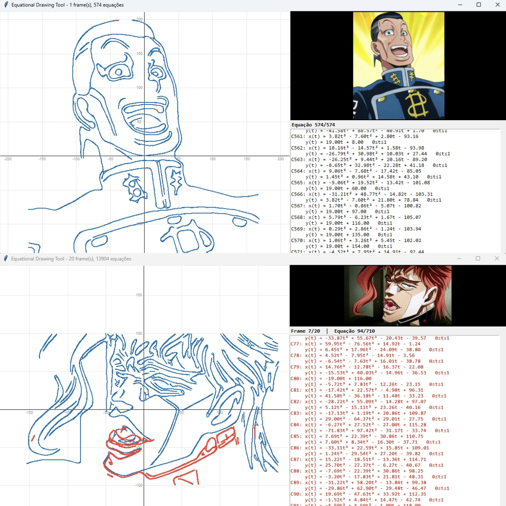
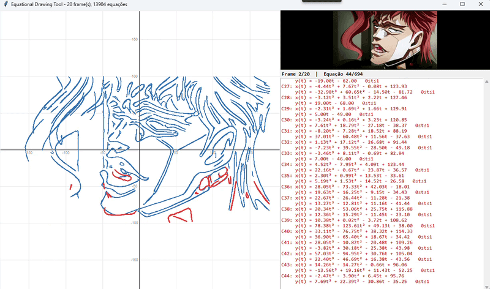

O Seguinte projeto veio em mente após eu ver um matemático desenhando uma borboleta com equações em um post feito no linkedin.

decidi fazer o mesmo porem com python, você cola uma imagem e ele a reescreve em um formato de desenho em equações em um plano cartesiano, também funciona com gifs.

